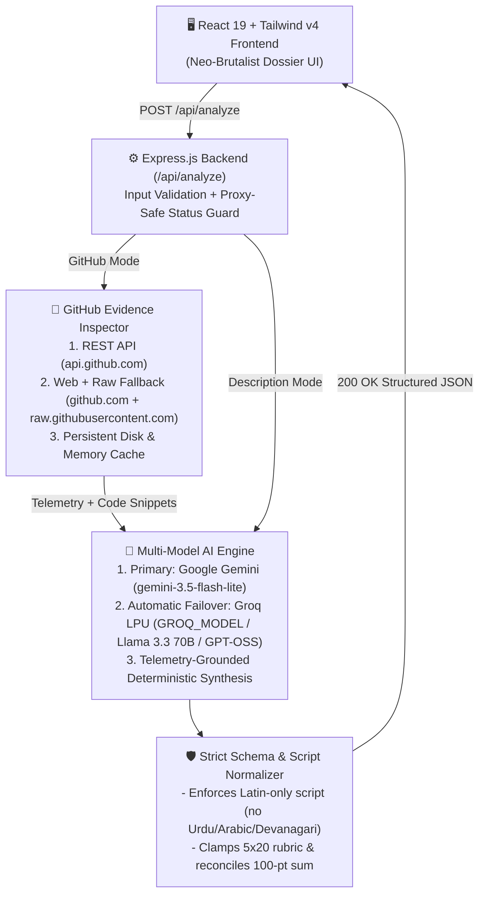

<div align="center">

# ⚡ TechUstaad

### *"Code Likha Hai Ya Sirf Folder Banaya Hai?"*

**AI-Powered Project Roast & 100-Point Engineering Reality-Check Platform**  
*Brutally honest Pakistani Senior Developer persona — pehle savage roast, phir proper software engineering advice.*

[](https://ais-pre-vdoepmypgaqctwdkmo4zyo-745066554425.asia-southeast1.run.app)
[](https://github.com/abdulhayykhan/TechUstaad)
[](https://ai.google.dev/)
[](https://groq.com/)
[](https://www.typescriptlang.org/)
[](#license)

---

**Built with ❤️ by [Abdul Hayy Khan](https://abdulhayykhan.dev/) for Prompt Wars by GDGoC MAJU**

</div>

---

## 📖 Table of Contents

1. [Overview & Product Identity](#-1-overview--product-identity)
2. [Why TechUstaad? (The Dual-Stage Philosophy)](#-2-why-techustaad-the-dual-stage-philosophy)
3. [Key Features](#-3-key-features)
4. [Transparent 100-Point Scoring Rubric](#-4-transparent-100-point-scoring-rubric)
5. [System Architecture & Multi-Tier Resilience](#-5-system-architecture--multi-tier-resilience)
6. [Design System: Neo-Brutalist Pastel Dossier](#-6-design-system-neo-brutalist-pastel-dossier)
7. [Tech Stack](#-7-tech-stack)
8. [Project Structure](#-8-project-structure)
9. [API Reference](#-9-api-reference)
10. [Local Development & Setup](#-10-local-development--setup)
11. [Testing & Verification](#-11-testing--verification)
12. [Deployment](#-12-deployment)
13. [Author & Attribution](#-13-author--attribution)

---

## 🔥 1. Overview & Product Identity

**TechUstaad** is an AI-powered software project roast and engineering reality-check platform built with the unmistakable personality of a battle-tested Pakistani senior developer who has reviewed one too many last-minute FYPs, unfinished hackathon repos, tutorial clones, overengineered microservice architectures for 3 users, and *"AI-powered"* apps that are just a single prompt wrapped in a gradient button.

### Core Principle
> **First, make the developer laugh. Then make them improve their project.**

Unlike generic, overly polite AI code reviewers that output forgettable boilerplate, **TechUstaad** inspects real repository evidence (or a detailed project description) and delivers a **Two-Stage Engineering Dossier**:
- **Stage 01 — Ustaad Ka Roast (Roman Urdu / Hinglish + English):** Sharp, culturally resonant developer humor calling out God files, missing tests, copy-paste commits, and buzzword inflation—strictly roasting the *project*, never the person.
- **Stage 02 — Engineering Reality Check & Action Plan:** A rigorous, senior-mentor post-mortem across four architectural dimensions, a transparent **100-point rubric breakdown (5 × 20 pts)**, and a prioritized roadmap (`Fix Immediately`, `Improve Next`, `Future Enhancements`) calibrated to your team size and deadline.

---

## 🧠 2. Why TechUstaad? (The Dual-Stage Philosophy)

| Dimension | Generic AI Code Reviewers | ⚡ TechUstaad |
| :--- | :--- | :--- |
| **Tone & Personality** | Robotic, repetitive corporate boilerplate | Witty Pakistani Senior Lead (English + natural Roman Urdu/Hinglish) |
| **Evidence Grounding** | Often hallucinates files or assumes runtime behavior | Inspects real GitHub file trees, README, commits, and source files; explicitly separates **Observed Evidence** vs **Assumptions** |
| **Input Flexibility** | Requires OAuth or repository write access | Works on **any public GitHub repository URL** OR **Project Description mode** (zero repo required) |
| **Scoring Transparency** | Arbitrary single number with no breakdown | Deterministic **5 × 20 pt = 100 pt rubric** where category scores strictly sum to the total |
| **Actionability** | Vague advice (*"add more tests"*) | Structured cards detailing **What to Change**, **Why It Matters**, and **How to Approach** |

---

## ✨ 3. Key Features

### 🔍 Dual Input Modes
1. **Public GitHub Repository Analyzer**
   - Accepts full URLs (`https://github.com/owner/repo`) or shorthand (`owner/repo`).
   - Validates owner/repository syntax and rejects profile URLs or non-GitHub links before network calls.
   - Extracts repository metadata, language distribution, recent commit messages, `README.md`, file tree structure, detected test suites, config manifests, and up to 4 representative source/config files.
2. **Project Description Mode (No Repo Needed)**
   - Built for private codebases, early FYP proposals, or architecture pitches.
   - Never penalizes blindly for unseen source code—explicitly flags unverified areas as *"Insufficient Evidence"* in the rubric.

### 🎛️ Context-Calibrated Recommendations
Optional context selectors allow Ustaad to tailor the action plan to your real-world constraints:
- **Project Type:** `FYP`, `Hackathon Project`, `Personal Project`, `Internship Project`, `Course Assignment`, `Startup / MVP`
- **Developer Experience:** `Beginner`, `Intermediate`, `Advanced`
- **Available Time:** `One Day`, `One Week`, `Two Weeks`, `One Month`
- **Team Size:** `Solo`, `2–3 Members`, `4+ Members`

### 📋 Shareable & Exportable Verdict Dossier
- **One-Click Copy Roast:** Copies the headline, Roman Urdu/Hinglish roast, score, and punchlines formatted for WhatsApp, Discord, X/Twitter, or LinkedIn.
- **One-Click Copy Action Plan:** Copies the prioritized engineering checklist (`Fix Immediately`, `Improve Next`, `Future`) for GitHub Issues or Notion.
- **Download Full Markdown Report (`.md`):** Exports the entire 2-stage dossier, 100-point rubric table, and engineering audit as a clean `.md` file.

---

## 📊 4. Transparent 100-Point Scoring Rubric

Every project is evaluated across **five equally weighted 20-point pillars** (`5 × 20 = 100`). Server-side normalization guarantees that individual category scores are clamped to `0–20` and strictly sum to `total_score`.

| Pillar | Max Score | What Ustaad Evaluates |
| :--- | :---: | :--- |
| **1. Code Quality** | `20 pts` | Readability, naming conventions, modularity, DRY principles, file size discipline, and maintainability. |
| **2. Architecture & Design** | `20 pts` | Directory structure, separation of concerns, sensible stack choices, and scope-appropriate complexity. |
| **3. Functionality & Implementation** | `20 pts` | Completeness of core flow, real implementation evidence vs. README buzzword inflation, and practical utility. |
| **4. Documentation & Presentation** | `20 pts` | README clarity, setup reproducibility, environment variable documentation (`.env.example`), and architecture overview. |
| **5. Testing & Reliability** | `20 pts` | Automated test presence, input validation, graceful error handling, edge-case protection, and secret hygiene. |

### Score Tier Interpretation
- **`86 – 100` (`Production-Minded — Ustaad Approved`)**: Clean architecture, documented setup, real tests, and solid engineering discipline.
- **`71 – 85` (`Solid Effort — Needs Polish Before Production`)**: Strong core execution with specific gaps in testing, modularity, or edge-case hardening.
- **`51 – 70` (`Kaam Chalau — Typical FYP / Hackathon Zone`)**: Functional prototype held together by hope and hardcoding; needs architectural cleanup.
- **`31 – 50` (`Danger Zone — Viva Mein Paseene Aayenge`)**: Heavy buzzword-to-code ratio, missing fundamentals, or monolithic spaghetti.
- **`0 – 30` (` Sirf Folder Banaya Hai — Emergency Refactor Needed`)**: Barely initialized skeleton or severe structural issues.

---

## 🏗️ 5. System Architecture & Multi-Tier Resilience

TechUstaad is engineered so that live demos, hackathon judging sessions, and shared Cloud Run IPs **never break** due to upstream API rate limits or model demand spikes.



### Key Reliability Engineering Highlights
1. **Centralized Gemini Configuration (`/server/config.ts`)**:
   - Uses `GEMINI_MODEL_ID = 'gemini-3.5-flash-lite'` defined in a single configuration module.
   - All API keys (`GEMINI_API_KEY`, `GROQ_API_KEY`) remain strictly server-side and are never exposed to the client bundle.
2. **Multi-Provider AI Failover (`/server/geminiService.ts`)**:
   - Attempts `gemini-3.5-flash-lite` first with structured JSON schema output.
   - If Gemini experiences upstream `503 UNAVAILABLE` high-demand spikes, quota exhaustion, or timeouts, a 90-second circuit breaker activates and seamlessly routes requests to **Groq Cloud LPU** (`GROQ_MODEL`, failing over across `llama-3.3-70b-versatile`, `openai/gpt-oss-120b`, `meta-llama/llama-4-scout-17b-16e-instruct`, and `llama-3.1-8b-instant`).
3. **GitHub Rate-Limit Bypass & Caching (`/server/githubAnalyzer.ts`)**:
   - Unauthenticated `api.github.com` requests are limited to 60/hr per IP. TechUstaad fetches README and source files via `raw.githubusercontent.com` to conserve quota, caches repository inspections in memory and `/tmp/techustaad-github-cache.json`, and automatically falls back to GitHub web route embedded metadata if the REST API rate limit is reached.
4. **Latin-Script & Schema Enforcement (`/src/utils/validation.ts`)**:
   - Validates every AI response against Unicode ranges `[\u0600-\u06FF]` (Urdu/Arabic) and `[\u0900-\u097F]` (Devanagari) to guarantee all Roman Urdu/Hinglish output uses clean Latin characters.

---

## 🎨 6. Design System: Neo-Brutalist Pastel Dossier

Inspired by [Rishta Aunty](https://github.com/abdulhayykhan/Rishta-Aunty) (Winner at *Chai aur Code ep#2 by GDG Live Pakistan*) and modern Neo-Brutalist editorial dashboards:

- **Atmosphere & Surfaces:** Warm cream canvas (`#FFFDF7`) layered over a subtle pastel mesh gradient (`#FFD6E7` rose, `#CCF2FF` sky cyan, `#E2D9FF` lavender, `#FFF3B0` butter yellow) with a tactile 24px architectural dot-grid.
- **Neo-Brutalist Geometry:** `3px solid #111111` borders, crisp `6px 6px 0px #111111` hard offset shadows, and tactile button press physics (`translate(2px, 2px)` on click).
- **Typography:**
  - **Display Headlines:** `Bricolage Grotesque` (800 ExtraBold)
  - **Body & Engineering Analysis:** `Plus Jakarta Sans` (400/500/600/700)
  - **Scores, Telemetry & Badges:** `JetBrains Mono` (`tabular-nums`)

---

## 🛠️ 7. Tech Stack

- **Frontend:** React 19, TypeScript, Tailwind CSS v4 (`@tailwindcss/vite`), Lucide React Icons
- **Backend:** Node.js (v22 ESM), Express.js, Vite Middleware (development) / Static SPA Server (production)
- **AI & LLM SDKs:** Google Gen AI SDK (`@google/genai` — `gemini-3.5-flash-lite`), Groq Cloud OpenAI-Compatible API (`GROQ_API_KEY`)
- **Data & Validation:** Custom deterministic schema normalizer, Unicode script sanitizer, Node.js native test runner (`node:test`)
- **Build & Bundling:** Vite 8 + esbuild (production server bundle)

---

## 📂 8. Project Structure

```text
TechUstaad/
├── public/
│   └── favicon.ico                 # App icon & favicon
├── server/
│   ├── config.ts                   # Central GEMINI_MODEL_ID ('gemini-3.5-flash-lite') & timeout/Groq config
│   ├── githubAnalyzer.ts           # GitHub REST API + web/raw fallback + disk-cached repo inspector
│   └── geminiService.ts            # Prompt builder, Gemini SDK call, Groq failover & telemetry synthesizer
├── src/
│   ├── components/
│   │   ├── Navbar.tsx              # Top Neo-Brutalist navigation bar & quick actions
│   │   ├── HeroSection.tsx         # Asymmetric split hero + Ustaad Dual-Core preview window
│   │   ├── AnalyzerSection.tsx     # GitHub URL / Description tabs, context selectors & step-by-step loader
│   │   ├── ResultsSection.tsx      # 2-Stage Verdict Dossier, 100-pt rubric bars, priority tabs & export tools
│   │   └── MethodologyAndFooter.tsx# 5x20 rubric explainer, 4-step methodology & required author attribution
│   ├── data/
│   │   └── sampleReports.ts        # Pre-validated instant demo dossiers (Rishta-Aunty 76/100 & FYP 37/100)
│   ├── types/
│   │   └── analysis.ts             # Shared frontend/backend TypeScript interfaces
│   ├── utils/
│   │   ├── validation.ts           # URL parser, Latin-script validator & 100-point rubric normalizer
│   │   └── validation.test.ts      # Automated unit test suite for URL parsing & schema normalization
│   ├── App.tsx                     # Root application state & smooth section orchestration
│   ├── index.css                   # Tailwind v4 imports & Neo-Brutalist utility classes
│   └── main.tsx                    # React DOM entry point
├── .env.example                    # Environment variable template (no secrets)
├── index.html                      # SEO, OpenGraph, Twitter Card & Schema.org WebApplication JSON-LD
├── metadata.json                   # AI Studio applet metadata
├── package.json                    # Scripts & dependencies
├── server.ts                       # Full-stack Express + Vite/static production server entry point
├── tsconfig.json                   # TypeScript compiler configuration
└── vite.config.ts                  # Vite bundler configuration
```

---

## 🔌 9. API Reference

### `GET /api/health`
Returns service readiness and non-sensitive configuration status (never exposes API keys).

**Response (`200 OK`):**
```json
{
  "status": "ok",
  "service": "TechUstaad",
  "model": "gemini-3.5-flash-lite",
  "apiKeyConfigured": true,
  "groqFallbackConfigured": true,
  "groqModel": "openai/gpt-oss-20b"
}
```

### `POST /api/analyze`
Analyzes either a public GitHub repository URL or a project description and returns the complete validated `AnalysisResponse`.

**Request Body (`application/json`):**
```json
{
  "mode": "github",
  "githubUrl": "https://github.com/abdulhayykhan/Rishta-Aunty",
  "context": {
    "projectType": "Hackathon Project",
    "experienceLevel": "Intermediate",
    "availableTime": "One Week",
    "teamSize": "Solo"
  }
}
```

**Response (`200 OK`):**
Returns structured JSON containing:
- `project_summary` (`project_name`, `detected_type`, `primary_stack[]`, `purpose_summary`, `confidence_level`, `confidence_explanation`)
- `roast` (`headline`, `opening_roast`, `observations[]`, `CLOSING_LINE`)
- `reality_check` (`overview`, `strengths[]`, `key_issues[]`, `architecture_assessment`, `code_quality_assessment`, `documentation_assessment`, `testing_and_reliability_assessment`)
- `improvements` (`fix_immediately[]`, `improve_next[]`, `future_enhancements[]` — each with `title`, `what_to_change`, `why_it_matters`, `how_to_approach`)
- `score` (`total_score`, `verdict_label`, `verdict_summary`, `categories` with 5 × 20-pt breakdowns)
- `meta` (`analysis_mode`, `analyzed_at`, `model_used`, `repository_telemetry`, `evidence_notes[]`)

---

## 💻 10. Local Development & Setup

### Prerequisites
- **Node.js** `v20+` or `v22+`
- **npm** or **bun**
- A **Google Gemini API Key** ([Get one from Google AI Studio](https://aistudio.google.com/apikey))
- *(Optional)* A **Groq API Key** ([Get one from Groq Console](https://console.groq.com/keys)) for automatic multi-provider failover

### 1. Clone the Repository
```bash
git clone https://github.com/abdulhayykhan/TechUstaad.git
cd TechUstaad
```

### 2. Install Dependencies
```bash
npm install
```

### 3. Configure Environment Variables
Copy `.env.example` to `.env` and add your API keys:
```bash
cp .env.example .env
```

Edit `.env`:
```env
GEMINI_API_KEY="your_gemini_api_key_here"
GROQ_API_KEY="your_optional_groq_api_key_here"
GROQ_MODEL="llama-3.3-70b-versatile"
APP_URL="http://localhost:3000"
```

### 4. Start the Full-Stack Development Server
```bash
npm run dev
```
Open **`http://localhost:3000`** in your browser.

---

## 🧪 11. Testing & Verification

Run the automated TypeScript typecheck and unit test suite:

```bash
# Typecheck all frontend and backend TypeScript modules
npm run lint

# Run unit tests (GitHub URL parser, Latin-script enforcement, 100-pt rubric normalizer)
npx tsx --test src/utils/validation.test.ts
```

---

## 🚀 12. Deployment

TechUstaad is ready to deploy as a unified full-stack Node.js service on **Google Cloud Run**, **Google AI Studio**, **Render**, **Railway**, or **Fly.io**.

```bash
# Build the Vite frontend into dist/ and bundle the server into server.js
npm run build

# Start the production server (binds to process.env.PORT || 3000)
npm start
```

---

## 👨‍💻 13. Author & Attribution

<div align="center">

Made with ❤️ by **[Abdul Hayy Khan](https://abdulhayykhan.dev/)** for **Prompt Wars by GDGoC MAJU**

🌐 **Portfolio:** [abdulhayykhan.dev](https://abdulhayykhan.dev/) · 🐙 **GitHub:** [@abdulhayykhan](https://github.com/abdulhayykhan)

</div>

---

## 📄 License

This project is licensed under the **MIT License**.
